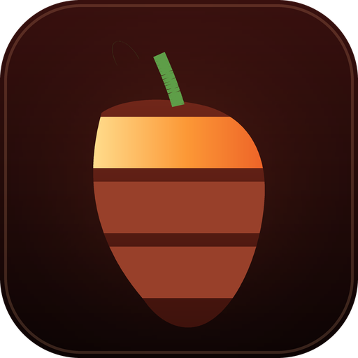
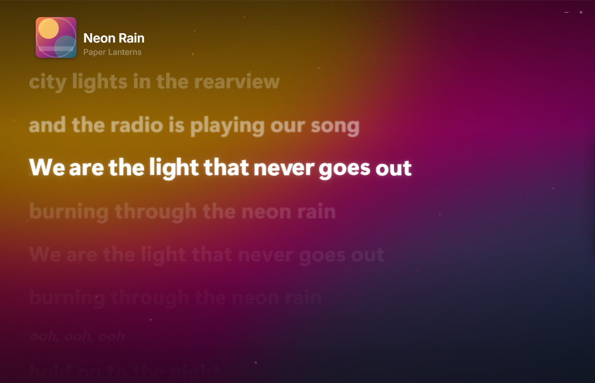
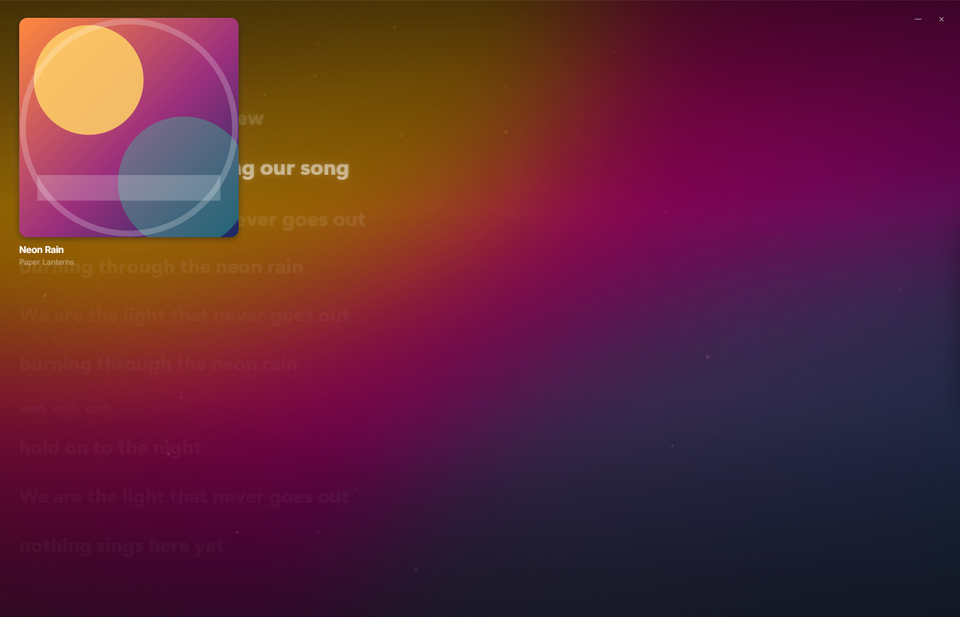
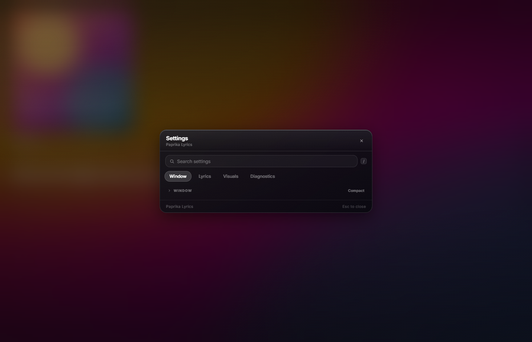

<div align="center">



# Paprika Lyrics

**Studio-accurate, syllable-by-syllable lyrics for whatever your PC is playing.**
A frameless Windows overlay that reads the media session, not your audio — so Spotify, YouTube, VLC, Foobar, SimpMusic and anything else that reports now-playing all work.

[](https://github.com/GZomeMain/paprika-lyrics/actions/workflows/ci.yml)
[](LICENSE)
[](https://www.python.org/)
[](#requirements)

[**⬇️ Download**](https://github.com/GZomeMain/paprika-lyrics/releases/latest) · [Highlights](#highlights) · [Quick start](#quick-start) · [Controls](#controls) · [Under the hood](#under-the-hood) · [API key](#your-spicy-lyrics-api-key)



</div>

---

## What it does

Paprika Lyrics draws song lyrics over your desktop — one word at a time, on the beat, in a window that can be a small floating card, a split pane with the cover art, or a full-screen lyric field.

It follows **whatever your PC is playing** by reading the track from Windows' own media controls (GSMTC), so it is not tied to one app. **No audio is ever captured or analysed**: the overlay listens to the *media session*, not the music.

For songs with syllable timing it wipes word-by-word and per-syllable. For everything else it falls back to line-synced lyrics and keeps going.

## Highlights

- **🎤 Syllable-perfect lyrics** — Apple Music / community TTML via the [Spicy Lyrics API](https://developers.spicylyrics.org), with line-synced fallback from [LRCLIB](https://lrclib.net/).
- **🌍 Any player** — Spotify, YouTube / YouTube Music, SimpMusic, Foobar2000, Groove, VLC, and anything else that publishes now-playing to Windows.
- **🖼️ Album-art room** — the live cover becomes a blurred, colour-matched backdrop; the room and the sleeve are lit in the artwork's own colour.
- **☁️ Room air** — a drifting field of motes, tinted per half of the cover, sitting in front of the grade and behind the words.
- **🥁 Beat-synced light** — a rhythm model estimated from the lyric timeline drives the room's breath, the sleeve's pulse and the lamp around it, with builds and drops shaped differently.
- **💃 Real lyric motion** — per-word lift and bloom, chorus halos, duet stagger, ad-lib asides, and depth of field that keeps the live line crisp.
- **🪟 Windows-native shell** — frameless, always-on-top, mini player, click-through mode, native anchored resize, global hotkeys.
- **🔤 Your own fonts · 🧩 your own lyrics** — import font faces for lyrics or UI; keep local `.ttml` files for the tracks the online lookup gets wrong.
- **🪶 Quiet by default** — every long-running effect animates `transform` / `opacity`, honours reduced motion, and stops entirely when you pause.

<p align="center">
  
</p>

## Quick start

```bash
git clone https://github.com/GZomeMain/paprika-lyrics.git
cd paprika-lyrics

pip install -r requirements.txt
copy .env.example .env      # then paste your Spicy Lyrics key into .env
python paprika_app.py
```

Play any track and the overlay picks it up. Prefer a prebuilt binary? Grab the zip from [Releases](https://github.com/GZomeMain/paprika-lyrics/releases/latest), unpack it and run `PaprikaLyrics.exe`.

> **Track IDs:** the lyrics API takes a Spotify track ID, not a title, so the app resolves one itself — a Spotify search over `requests` alone, which is the lookup a prebuilt exe uses. `pip install spotifyscraper==3.9.2` adds the [AliAkhtari78/SpotifyScraper](https://github.com/AliAkhtari78/SpotifyScraper) lookup, which then goes first, as it always has; it is guarded at import and nothing requires it.

## Requirements

| | |
| --- | --- |
| **OS** | Windows 10 (1809+) or Windows 11, 64-bit |
| **Runtime** | Microsoft Edge **WebView2** (preinstalled on Windows 11 and current Windows 10) |
| **Python** | 3.10 – 3.13, only when running from source |

## Your Spicy Lyrics API key

The key unlocks **word-by-word** lyrics. Without it the app still runs, on line-synced lyrics — so this is optional, but it is the whole point.

1. Open **[developers.spicylyrics.org](https://developers.spicylyrics.org)** → **Dashboard** → **Create an application**.
2. Copy the **secret key** (`sl_sk_…`) — it is shown only once.
3. Paste it **in the app**: <kbd>Ctrl</kbd> + <kbd>,</kbd> → **Lyrics** tab → **Spicy Lyrics API** → **Save**. Or put it in `.env`:

```env
SPICY_API_KEY="sl_sk_your_key_here"
SPICY_BASE_URL=https://api.spicylyrics.org
```

A real environment variable always outranks `.env`, and `.env` is git-ignored. Confirm it took with **Settings → Diagnostics → Resolve report** (`API key: Set`).

The API takes a **Spotify track ID**, not a title, so the app resolves one from the track and artist first. When a track ends up on line-synced lyrics, the same resolve report now says which step lost it: `Resolution: no Spotify track id found` is the lookup failing, `Spicy skipped · no API key` is the key, and `no lyrics for this track` is the API genuinely having none.

## Controls

| Action | Shortcut / gesture |
| --- | --- |
| Nudge lyrics later / earlier | <kbd>Ctrl</kbd> + <kbd>[</kbd> / <kbd>Ctrl</kbd> + <kbd>]</kbd> — system-wide, ±50 ms |
| Zoom lyric size | <kbd>Ctrl</kbd> + mouse wheel |
| Move / resize the window | Drag the top strip, or any edge / corner |
| Open settings | <kbd>Ctrl</kbd> + <kbd>,</kbd>, or the gear on the cover |
| Translations & romanisation | <kbd>T</kbd> — also in Settings |
| Click-through (ignore the mouse) | <kbd>Ctrl</kbd> + <kbd>Shift</kbd> + <kbd>T</kbd> |
| Peek (hand the mouse back) | <kbd>Ctrl</kbd> + <kbd>Shift</kbd> + <kbd>M</kbd> |
| Close a panel / leave the mini player | <kbd>Esc</kbd> |
| Play · pause · seek | On-cover transport and seek bar |

Sync offsets are saved **per track**, so a song only ever needs nudging once.

<details>
<summary><b>Settings, at a glance</b></summary>

<br>



Four tabs — **Window**, **Lyrics**, **Visuals**, **Diagnostics** — and a search box (<kbd>/</kbd>) that filters the rows in place. Every motion effect (**Beat sync**, **Big moments**, **Room air**, **Tilt**) carries the same three modes: **Off / Subtle / Bold**. Window owns layout, alignment, opacity, always-on-top, click-through and card position; Lyrics owns the source, secondary lines, fonts, the API key and the local `.ttml` library; Diagnostics holds the resolve report.

</details>

## Under the hood

A small Python host drives one WebView2 window. The host owns the operating-system work; the overlay owns nothing but pixels.

```
Windows media session (GSMTC)
        │  core/session.py   pick the best session, watch it change
        ▼
core/smtc.py  ── transport, position, timeline ──┐
                                                 │
lyric resolution  core/resolver.py               │
   Spotify search → Spicy Lyrics API → LRCLIB    │
        │                                        │
        ├── core/ttml.py · core/ttml_library.py  │  Apple / AMLL syllable timing
        └── core/lyrics.py                      │
        ▼                                        ▼
core/beat.py beat plan   core/timeline.py syllable timeline   storage.py cache
        │
        ▼
   ui/app.js  ── DOM + WebView2 ──  ui/style.css  ── compositor
        ▲
paprika_app.py  (pywebview host, Win32 window control, hotkeys, file dialogs)
```

**Repository map**

| Path | What lives there |
| --- | --- |
| `paprika_app.py` | The host: window, bridge API, hotkeys, dialogs, event loop |
| `core/session.py` · `core/smtc.py` | Which media session is live, and its transport/position |
| `core/resolver.py` · `core/lyrics.py` | Track → synced lyrics, tier by tier, with caching |
| `core/ttml.py` · `core/ttml_library.py` | Syllable parsing and the local `.ttml` library |
| `core/beat.py` | The rhythm plan: BPM, phase, per-section strength, builds, drops |
| `core/timeline.py` | The syllable clock the UI renders against |
| `core/native_window.py` · `core/hotkeys.py` | Win32 frame/fullscreen/drag, global shortcuts |
| `core/font_library.py` | Importing and reading font faces (with a `.trash`, not a delete) |
| `ui/` | The whole overlay: `index.html`, `app.js`, `style.css` |
| `storage.py` · `config.py` | Cache, and every path and environment variable |

### The motion system

The overlay has one rule: **one layer, one property, one owner.** A CSS custom property is either written by the beat, the moment grade, the pointer lean or the lyric engine — never two of them.

- `--art-accent` (the cover's own colour) and `--dust-op` are registered `@property` values, so a track change **cross-fades** the light instead of flicking to a new hue.
- The **beat** owns `transform` on the backdrop and the sleeve; the **moment grade** owns `opacity` on the veil; the **pointer lean** owns the registered `--tilt-x` / `--tilt-y` pair, which eases on the root at 90 ms — short enough that the sleeve settles *behind* the cursor rather than trailing it.
- The room counter-moves against the sleeve (−28 px per unit of lean), so the cover reads as standing proud of the wall behind it.
- The heartbeat is a real model, not a timer: `core/beat.py` estimates BPM and phase from lyric onsets, then publishes `--beat-ms`, `--beat-lead-ms` and a per-section `--beat-strength`. The pulse is phase-led so the swell **lands** on the beat.
- Every long-running effect animates `transform` or `opacity` (the sleeve's pulse also animates a small shadow). The backdrop's pulse is opacity-only precisely so a 40 px blur is never re-rasterised per frame.
- **Reduced motion** (Windows' own setting, or the in-app toggle) leaves every layer stock: no drift, no pulse, no air, no lean, no grade.
- Lyrics keep their own clock: syllable state is committed on the timeline, and a correction never walks the wipe backwards over letters it has already sung.

### Performance

Measured on the dev machine with the beat, the wipe and the room all live (renderer counters via CDP, no GPU claims):

| | |
| --- | --- |
| Frame pacing | p50 **13.3 ms**, no frame over 20 ms across a 2.5 s sample |
| Main-thread task time | ~**0.5 s per 3 s** of playback (~2% scripting, ~5% style) |
| Long-running animations | ~47, of which **37 composite on the GPU**; 28 of those are air motes |
| Blur | a single `blur()` on one layer, scaled with the window (26 – 54 px) and overscanned so edges never erode |

### Data, paths and configuration

Everything the app **writes** lives beside it — never inside the bundle, never in `%TEMP%`: `.env`, `.webview/` (WebView2 profile = all persisted settings), `ttml/`, `fonts/`, `spotify_cache.json`, `logs/`.

| Variable | Default | Purpose |
| --- | --- | --- |
| `SPICY_API_KEY` | — | Spicy Lyrics secret key (`sl_sk_…`) |
| `SPICY_BASE_URL` | `https://api.spicylyrics.org` | Lyrics API root (self-hosters) |
| `SPICY_TTML_DIR` | `./ttml` | Local syllable-lyric library |
| `SPICY_FONT_DIR` | `./fonts` | Imported font faces |
| `SPICY_WEBVIEW_DIR` | `./.webview` | WebView2 profile — deleting it resets every setting |
| `SPICY_CACHE_TTL_SECONDS` | `259200` (3 days) | How long a cached lyric payload stays fresh |
| `SPICY_DEBUG` | `0` | Verbose resolver / lyrics logging |

## Local lyrics (`.ttml`)

For tracks the online lookup gets wrong, keep your own Apple / AMLL `.ttml` files:

- Drop files into `ttml/` (or **Settings → Local lyrics → Import files…**), then **Rescan**.
- A file is applied automatically only when its own metadata names the **same title and artist**; a hand-bound file always wins.
- Removals go to `ttml/.trash`, so a mistake is recoverable.
- Point the library elsewhere with `SPICY_TTML_DIR`.

## Fonts

**Settings → Fonts** lists every face the overlay can draw in — the stock ones, then whatever you imported:

- **Add font…** takes several files at once and **copies** them into the fonts folder, so an import survives a restart (no cap on how many you keep).
- Each row is drawn **in the face it names** — pick by looking, not by reading file names.
- **Remove** moves a file to `fonts/.trash`; a file whose bytes will not load is listed as unreadable rather than applied or silently ignored.
- Imports are registered at runtime: a new face applies the moment you pick it.

## Build a standalone `.exe`

```bash
pip install pyinstaller
python -m PyInstaller PaprikaLyrics.spec --noconfirm                 # dist/PaprikaLyrics/ (folder)
PL_ONEFILE=1 python -m PyInstaller PaprikaLyrics.spec --noconfirm    # dist/PaprikaLyrics.exe (one file)
```

The default is a **onedir** build — `dist/PaprikaLyrics/` with the exe inside it — so ship the whole folder; that is what the release zip is, and what the app is designed around. Setting `PL_ONEFILE=1` produces a **single self-contained exe** instead, which the release also attaches for anyone who wants one file: it unpacks itself into a temp folder on every launch, so it starts slower, and it is the reason both exist rather than either alone. (PowerShell: `$env:PL_ONEFILE=1` before the command.)

Either build is unsigned, so SmartScreen warns on first run (*More info → Run anyway*). `ui/` is bundled as read-only data; `.env`, `.webview/`, `ttml/`, `fonts/` and the cache are deliberately **not**, so nothing a user changes is ever unpacked into `%TEMP%`.

Tagging a release (`git tag v0.2.2 && git push origin v0.2.2`) runs the same suite and publishes `PaprikaLyrics-windows-x64.zip` and `PaprikaLyrics.exe` together. A tag **with a suffix** (`v0.2.2-rc1`) publishes a GitHub **pre-release** instead, so a build for people to try is a naming decision rather than a second workflow — and `config.APP_VERSION` is what that tag should spell.

## Development

```bash
python -m compileall -q core config.py storage.py paprika_app.py tools
python -m unittest discover -s tests -v        # 590 tests
node tools/run-ui-preview-regression.mjs       # the overlay's own invariants
```

CI runs the suite on **Windows × Python 3.10 – 3.13** (the app is Windows-only, so a Linux runner would pass while the native paths went untested), plus a UI job that parses `app.js` and then **executes** the overlay checks in a headless Chromium over CDP at five viewports — from 1400×900 down to the smallest window the app allows.

## Troubleshooting

| Symptom | Fix |
| --- | --- |
| Lyrics are line-synced, not word-by-word | The track has no syllable sync, or the API key is missing — check **Settings → Resolve report**. |
| Lyrics are slightly ahead / behind | Nudge with <kbd>Ctrl</kbd> + <kbd>[</kbd> / <kbd>Ctrl</kbd> + <kbd>]</kbd> (saved per track). |
| Title shows `--:--` and the seek bar does nothing | Your player publishes no length to Windows (or blanked its timeline while the next item opened). The overlay re-reads it the moment the player announces one. |
| I can't click the overlay | It is in click-through mode — <kbd>Ctrl</kbd> + <kbd>Shift</kbd> + <kbd>T</kbd>. |
| Motion never stops | Turn off the individual effects, or switch **motion** to *Reduced* in Settings. |
| I want to reset everything | Delete the `.webview/` folder. |

## Credits

- **[Spicy Lyrics API](https://developers.spicylyrics.org)** — syllable-synced TTML payloads.
- **[LRCLIB](https://lrclib.net/)** — open, community lyric database (line-sync fallback).
- **[pywebview](https://pywebview.flowrl.com/)** — the WebView2 window container.
- **[SimpMusic](https://github.com/brahmkshatriya/SimpMusic)** — an excellent open-source YouTube Music client, and one of the players this overlay is tested against.

## License

MIT — see [LICENSE](LICENSE). Use it, fork it, ship it. No warranty.
