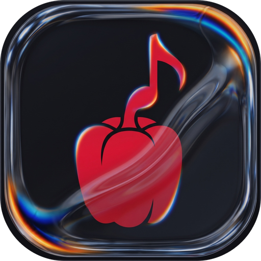
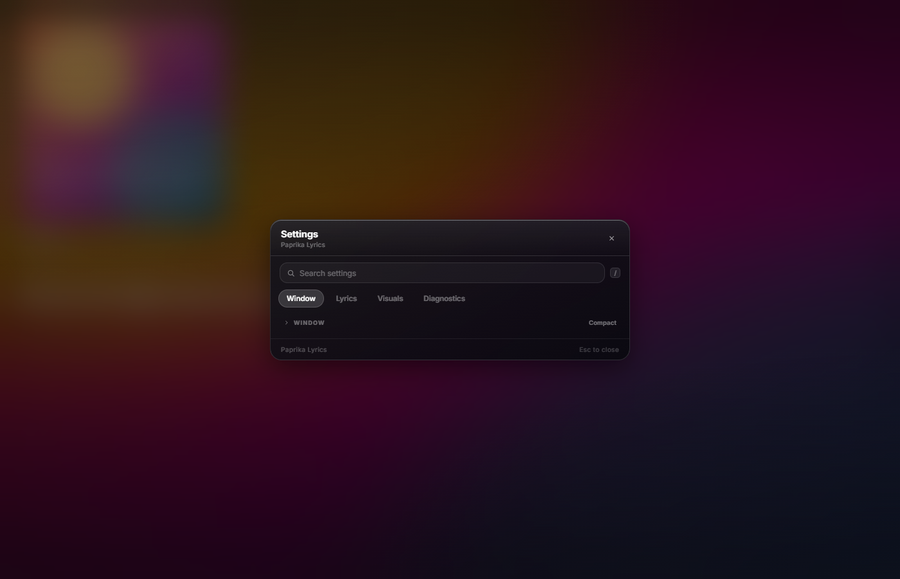

<div align="center">



# Paprika Lyrics

### ✨ Studio-accurate, syllable-by-syllable lyrics floating right on your Windows desktop.

Bring an Apple Music-style, beautifully animated karaoke lyric experience to whatever your PC is playing. Lightweight, frameless, and powered by Windows' native media session service (GSMTC) — no audio recording, no microphone permissions, and no account logins required.

[](https://github.com/GZomeMain/paprika-lyrics/actions/workflows/ci.yml)
[](https://github.com/GZomeMain/paprika-lyrics/releases/latest)
[](LICENSE)
[](https://www.python.org/)
[](#requirements)

[**⬇️ Download Latest Release (v0.3.3)**](https://github.com/GZomeMain/paprika-lyrics/releases/latest) · [Quick Start](#-quick-start) · [Features](#-features) · [Supported Players](#-supported-players) · [Controls](#️-controls--shortcuts) · [Architecture & Specs](#-architecture--under-the-hood)

<br>

https://github.com/user-attachments/assets/daa4370a-36d6-488a-907b-60a2d2e28301

</div>

---

## 💡 Why Paprika Lyrics?

- 🎯 **Just Works Out of the Box** — Open Paprika and hit play in Spotify, YouTube, or your favorite music player. The app immediately detects the song, syncs the timeline, and presents word-by-word lyrics.
- 🔒 **100% Private & Safe** — Paprika never listens to your microphone, records your audio stream, or inspects your personal files. It reads track metadata and timeline positions directly through official Windows APIs.
- 🪶 **Whisper-Light on Resources** — Designed to float seamlessly over work, web browsing, or gaming sessions. Rendering automatically suspends when music is paused.
- 🎨 **Living Album Atmosphere** — The interface samples your current album art in real-time, casting responsive ambient glows, fluid color gradients, and gentle particle motion.

---

## ✨ Features

- **🎤 Syllable-Perfect Lyrics** — Apple Music & community-curated TTML provided by the Spicy Lyrics API, with automatic intelligent fallback to line-synced [LRCLIB](https://lrclib.net/).
- **🎵 Universal Player Support** — Hooks into Windows System Media Transport Controls (GSMTC) to automatically follow Spotify, YouTube, Edge, Chrome, Apple Music, VLC, Foobar2000, and SimpMusic.
- **🖼️ Reactive Album Atmosphere** — Real-time dynamic background blur, chromatic aberration effects, and organic particle motes that softly drift with the mood of each track.
- **🥁 Beat-Driven Dynamics** — Rhythmic estimation and BPM detection from the lyric timeline produce smooth breathing pulses, bass blooms, and subtle card tilts.
- **🪟 Fluent Windows Desktop Overlay** — Borderless, always-on-top, click-through mode, customizable opacity, fluid resize handles, and dedicated mini-player mode.
- **🌐 Translations & Romaji** — Toggle instant Romanization (Romaji/Pinyin/etc.) and English translations for Japanese, Korean, Chinese, and foreign tracks.
- **🔤 Custom Fonts & Local TTML** — Drop in your own TTML files or favorite `.ttf`/`.otf` fonts; adjust typography scale, alignments, and text shadows.
- **⚡ Hardware Accelerated & Smart Idle** — Smooth 60–144Hz CSS transitions with zero unnecessary CPU wakeups when idle.

<div align="center">
  <br>

https://github.com/user-attachments/assets/966caaf1-7d9f-40b9-8aa6-39bd481f4a17

  <br>
</div>

---

## 🎧 Supported Players

Paprika Lyrics works out-of-the-box with any application that integrates with Windows Media Controls:

| Platform / App | Support Level | Notes |
| :--- | :--- | :--- |
| **Spotify** (Desktop) | Full Syllable Sync | Reads timeline & track properties directly via GSMTC |
| **Web Browsers** (Chrome, Edge, Firefox, Brave) | Full Syllable Sync | Works with YouTube, YouTube Music, SoundCloud, Bandcamp |
| **Apple Music & Tidal** (Windows Apps) | Full Syllable Sync | Native Windows media session support |
| **VLC Media Player** | Full Sync | Supports both local media sessions and VLC Lua HTTP control |
| **Foobar2000 & Groove** | Full Sync | Seamless GSMTC integration |
| **SimpMusic** | Full Sync & Docking | Built-in SimpMusic bridge with bidirectional sync & docking |

---

## 📦 Downloads & Releases

Prebuilt binaries for 64-bit Windows are published under [**Releases**](https://github.com/GZomeMain/paprika-lyrics/releases/latest). Choose the package that best fits your preference:

| Package | Format | Highlights | Download |
| :--- | :--- | :--- | :--- |
| **`PaprikaLyrics-windows-x64.zip`** | **Portable Folder Archive**<br>*(Recommended)* | • **Instant launch** with no temp file extraction<br>• Keeps dependencies pre-extracted in `_internal/`<br>• Easily configure custom fonts in `fonts/` and local lyrics in `ttml/` | [**Download ZIP**](https://github.com/GZomeMain/paprika-lyrics/releases/latest) |
| **`PaprikaLyrics.exe`** | **Single Executable** | • Single self-contained file with zero installation<br>• Portable: place anywhere (Desktop, USB drive) and run<br>• Unpacks to temp on start *(first run takes 2–3s)* | [**Download EXE**](https://github.com/GZomeMain/paprika-lyrics/releases/latest) |

> [!TIP]
> **Windows SmartScreen Note:** Because releases are open-source and unsigned, Windows Defender SmartScreen might show a protective prompt on first run (*"Windows protected your PC"*). Click **More info → Run anyway** to launch.

---

## 🚀 Quick Start

### Option A: Prebuilt Binary (Easiest)
1. Download `PaprikaLyrics-windows-x64.zip` (or `PaprikaLyrics.exe`) from [**Releases**](https://github.com/GZomeMain/paprika-lyrics/releases/latest).
2. Unpack the `.zip` archive into any folder (e.g., `C:\Apps\PaprikaLyrics`).
3. Double-click `PaprikaLyrics.exe` and start playing any music!

### Option B: Run from Source
If you are a developer or prefer running directly in Python:

```bash
# 1. Clone the repository
git clone https://github.com/GZomeMain/paprika-lyrics.git
cd paprika-lyrics

# 2. Install dependencies (Python 3.10 - 3.13 recommended)
pip install -r requirements.txt

# 3. Launch the app
python paprika_app.py
```

> **System Requirements:** Windows 10 (version 1809+) or Windows 11 (64-bit). The Microsoft Edge WebView2 runtime is preinstalled on Windows 11 and modern Windows 10 updates.

---

## ⌨️ Controls & Shortcuts

| Action | Shortcut / Gesture | Description |
| :--- | :--- | :--- |
| **Nudge Sync Offset** | <kbd>Ctrl</kbd> + <kbd>[</kbd> / <kbd>Ctrl</kbd> + <kbd>]</kbd> | Adjust sync by ±50 ms (automatically remembered per song) |
| **Reset Sync Offset** | <kbd>Ctrl</kbd> + <kbd>\</kbd> | Reset current song sync offset back to default |
| **Lyric Zoom** | <kbd>Ctrl</kbd> + <kbd>Scroll</kbd> | Dynamically scale font size up or down |
| **Move Window** | Click & drag top banner / background | Reposition overlay anywhere on your screen |
| **Resize Window** | Click & drag edges / corners | Smoothly resize width and height |
| **Settings Panel** | <kbd>Ctrl</kbd> + <kbd>,</kbd> (or click ⚙️) | Open quick settings, visuals, profiles, and diagnostics |
| **Translations / Romaji** | <kbd>T</kbd> | Toggle secondary lyrics (Romanized / English translations) |
| **Click-Through Mode** | <kbd>Ctrl</kbd> + <kbd>Shift</kbd> + <kbd>T</kbd> | Pass all mouse clicks through the window (great for gaming) |
| **Restore Focus** | <kbd>Ctrl</kbd> + <kbd>Shift</kbd> + <kbd>M</kbd> | Re-enable mouse interaction from click-through mode |
| **Mini Player Mode** | <kbd>Esc</kbd> (or top bar icon) | Collapse into an ultra-compact, floating lyrics bar |

---

<details>
<summary><b>⚙️ Settings & Customization Guide (Click to expand)</b></summary>

<br>

<div align="center">
  
</div>

The built-in settings console (<kbd>Ctrl</kbd> + <kbd>,</kbd>) offers rich customization across five dedicated tabs:

- **🪟 Window:** Adjust background glass opacity, backdrop blur, always-on-top, click-through mode, and layout styling (split album vs. unified lyrics).
- **🎤 Lyrics:** Select preferred TTML providers, enable local folder overrides (`ttml/`), toggle secondary translation layers, and switch font families.
- **✨ Visuals:** Fine-tune motion profiles (**Off / Subtle / Lively / Wild**) for beat pulses, room motes, card tilt, and optical chromatic aberration.
- **👥 Profiles:** Configure player-specific settings (e.g., custom latency profiles for Spotify vs. YouTube vs. VLC).
- **🔍 Diagnostics:** Inspect live GSMTC media session tokens, track signature hashes, resolver logs, and cache efficiency metrics.

</details>

---

<details>
<summary><b>🛠️ Architecture & Under the Hood (Click to expand)</b></summary>

<br>

Paprika pairs a high-performance Python host process with a hardware-accelerated WebView2 frontend through an asynchronous, low-latency IPC bridge:

```
Windows Media Session (GSMTC)
         │  core/session.py (Polls active OS audio sessions)
         ▼
core/smtc.py  ────── Transport, Timeline, Metadata ──────┐
                                                         │
Lyric Resolver  core/resolver.py                         │
   Spotify ID Match → Spicy Lyrics API → LRCLIB          │
         │                                               │
         ├── core/ttml.py · core/ttml_library.py         │  Syllable Timeline Engine
         └── core/lyrics.py                              │
         ▼                                               ▼
core/beat.py (BPM & Pulse)    core/timeline.py     storage.py (Local Cache)
         │                                               │
         ▼                                               ▼
     ui/app.js  ────────── WebView2 Bridge ──────────  ui/style.css
         ▲
paprika_app.py (pywebview host, Win32 window handles, global hotkeys)
```

### Key Subsystems
- **`core/timeline.py` (`PositionClock`)**: Normalizes disparate WinRT `datetime.timedelta` units, ages periodic snapshot write times, absorbs millisecond-level drift, protects pause transitions from backward rewind, and handles user seeks without playhead stutter.
- **`core/smtc.py`**: Interacts with Windows `GlobalSystemMediaTransportControlsSessionManager` using strict single-threaded COM dispatching, monitoring playback status, track metadata, and duration updates.
- **`core/resolver.py`**: Multi-tiered metadata resolver combining Spotify tokenless search, Spicy Lyrics TTML retrieval, and LRCLIB fallback with disk caching.
- **`ui/app.js` & `ui/style.css`**: GPU-accelerated styling with cubic-bezier spring physics, CSS variable animation, canvas particles, and wall-clock playhead prediction.

### Building Binaries Locally
To compile your own executable builds:

```bash
pip install pyinstaller
# 1. Standard folder build (dist/PaprikaLyrics/):
python -m PyInstaller PaprikaLyrics.spec --noconfirm

# 2. Standalone single-file executable (dist-onefile/PaprikaLyrics.exe):
PL_ONEFILE=1 python -m PyInstaller PaprikaLyrics.spec --noconfirm --distpath dist-onefile
```

> **Automated GitHub Releases:** Tagging a commit (e.g. `git tag v0.3.3 && git push origin v0.3.3`) automatically triggers GitHub Actions to run the full test suite, compile both distribution packages, and publish them to Releases.

</details>

---

## ❓ Frequently Asked Questions & Troubleshooting

| Issue | Cause & Recommended Resolution |
| :--- | :--- |
| **Lyrics show line-by-line rather than word-by-word** | Word-by-word (syllable-level) TTML is not yet community-synchronized for this track. Paprika smoothly falls back to line-synced lyrics from LRCLIB. |
| **Lyrics are slightly ahead or behind the audio** | Press <kbd>Ctrl</kbd> + <kbd>[</kbd> or <kbd>Ctrl</kbd> + <kbd>]</kbd> to nudge timing in ±50ms steps. Paprika remembers your exact adjustment for that song forever. |
| **Cannot click, drag, or interact with the window** | The overlay is in Click-Through mode. Press <kbd>Ctrl</kbd> + <kbd>Shift</kbd> + <kbd>M</kbd> or <kbd>Ctrl</kbd> + <kbd>Shift</kbd> + <kbd>T</kbd> to restore mouse focus. |
| **Timeline counter shows `--:--`** | Some web browsers or players do not report duration until playback begins. As soon as you hit play, the total time will appear. |
| **Song progress jumps when pausing** | Fixed in **v0.3.3**! Ensure you are running version 0.3.3 or later. |
| **Reset all settings and cache** | Exit Paprika, navigate to your app directory, and delete the local `.webview/` folder and `spotify_cache.json`. |

---

## 🤝 Community & Credits

Paprika Lyrics is made possible thanks to wonderful open-source tools and community APIs:

- **[Spicy Lyrics API](https://developers.spicylyrics.org)** — Syllable-synced TTML payloads and rich lyrics database.
- **[LRCLIB](https://lrclib.net/)** — Free, open community-sourced lyrics archive.
- **[pywebview](https://pywebview.flowrl.com/)** — Lightweight native WebView2 windowing container.
- **[WinRT / winsdk](https://github.com/pywinrt/python-winsdk)** — Native Windows System Media Transport Controls bindings.

---

## 📄 License

Distributed under the [MIT License](LICENSE). Built with ❤️ for music lovers everywhere.
